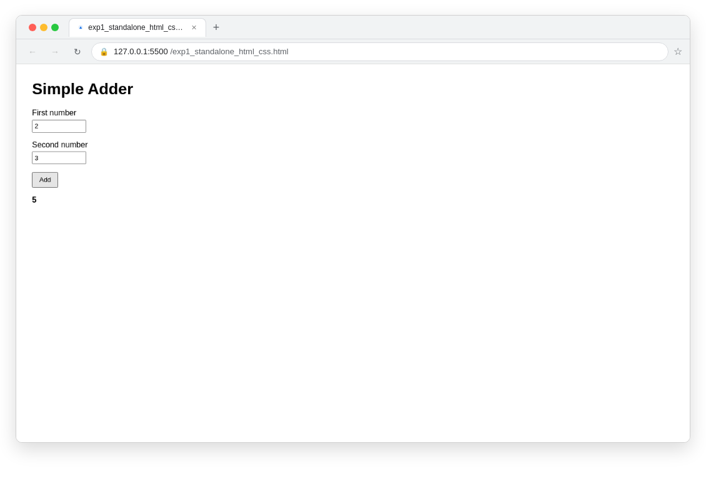
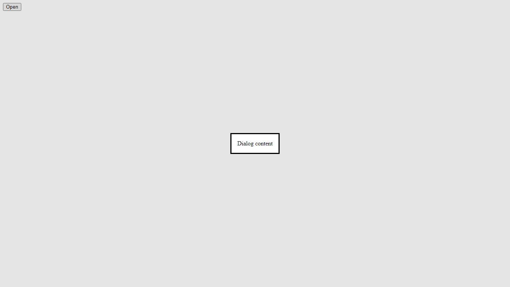
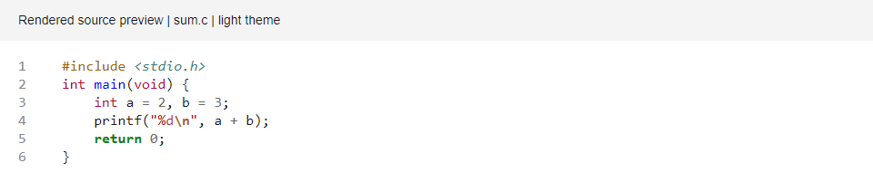
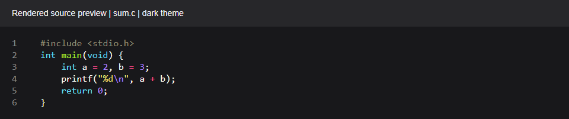

# LabMate test matrix

Audit: 16–17 October 2026 (India time). Actual compiler/process/browser/HTTP fixtures; no model mocks in the separate HTTP end-to-end test.

## Capability result interpretation

**83 actual capability cases: 66 PASS, 17 BLOCKED, 0 DEFECT.** A passing regression test for an unsupported framework asserts that execution is rejected; its capability remains BLOCKED.

Initial harness: 65 PASS, 17 BLOCKED, 1 DEFECT (`react_navigation`). The JSX defect was fixed and both the retest and final complete harness pass.

| Fixture | Language/category | Required observation | Result | Actual exit | Seconds |
| --- | --- | --- | --- | --- | --- |
| python_io | python / console | 14 | PASS | 0 | 0.132 |
| python_conditions | python / console | positive | PASS | 0 | 0.117 |
| python_loops | python / console | 15 | PASS | 0 | 0.120 |
| python_functions | python / console | 36 | PASS | 0 | 0.126 |
| python_collections | python / console | 8 | PASS | 0 | 0.110 |
| python_classes | python / console | 9 | PASS | 0 | 0.109 |
| python_exceptions | python / console | handled | PASS | 0 | 0.114 |
| python_file | python / console | 42 | PASS | 0 | 0.109 |
| c_hello | c / console | hello | PASS | 0 | 1.056 |
| c_io | c / console | 14 | PASS | 0 | 0.222 |
| c_conditions | c / console | positive | PASS | 0 | 0.231 |
| c_loops | c / console | 15 | PASS | 0 | 0.239 |
| c_arrays | c / console | 12 | PASS | 0 | 0.269 |
| c_strings | c / console | 3 | PASS | 0 | 0.231 |
| c_pointers | c / console | 10 | PASS | 0 | 0.248 |
| c_structures | c / console | 9 | PASS | 0 | 0.243 |
| c_functions | c / console | 36 | PASS | 0 | 0.250 |
| c_compile_error | c / console | compile | PASS | 1 | 0.791 |
| c_runtime_error | c / console | runtime | PASS | 3 | 0.982 |
| cpp_hello | cpp / console | hello | PASS | 0 | 1.050 |
| cpp_io | cpp / console | 14 | PASS | 0 | 0.253 |
| cpp_conditions | cpp / console | positive | PASS | 0 | 0.281 |
| cpp_loops | cpp / console | 15 | PASS | 0 | 0.275 |
| cpp_arrays | cpp / console | 12 | PASS | 0 | 0.241 |
| cpp_strings | cpp / console | 3 | PASS | 0 | 0.282 |
| cpp_pointers | cpp / console | 10 | PASS | 0 | 0.240 |
| cpp_structures | cpp / console | 9 | PASS | 0 | 0.272 |
| cpp_functions | cpp / console | 36 | PASS | 0 | 0.240 |
| cpp_compile_error | cpp / console | compile | PASS | 1 | 0.798 |
| cpp_runtime_error | cpp / console | runtime | PASS | 3 | 0.921 |
| cpp_inheritance | cpp / console | 11 | PASS | 0 | 0.418 |
| java_hello | java / console | hello | PASS | 0 | 1.163 |
| java_operators | java / console | 14 | PASS | 0 | 0.403 |
| java_conditions | java / console | positive | PASS | 0 | 0.411 |
| java_loops | java / console | 15 | PASS | 0 | 0.439 |
| java_arrays | java / console | 12 | PASS | 0 | 0.394 |
| java_methods | java / console | 36 | PASS | 0 | 0.423 |
| java_oop | java / console | 11 | PASS | 0 | 0.429 |
| java_exception | java / console | handled | PASS | 0 | 0.425 |
| java_file | java / console | 42 | PASS | 0 | 0.486 |
| java_io | java / console | 14 | PASS | 0 | 0.452 |
| node_console | node / console | hello | PASS | 0 | 0.829 |
| node_file | node / console | 42 | PASS | 0 | 0.040 |
| node_error | node / console | handled | PASS | 0 | 0.046 |
| python_runtime_error | python / console | runtime | PASS | 1 | 0.884 |
| node_runtime_error | node / console | runtime | PASS | 1 | 0.826 |
| python_timeout | python / console | timeout | PASS | 124 | 0.851 |
| swing_button | java / java_swing | java_swing | BLOCKED | 69 | 0.000 |
| tkinter_button | python / tkinter | tkinter | BLOCKED | 69 | 0.000 |
| swing_label_change | java / java_swing | java_swing | BLOCKED | 69 | 0.000 |
| tkinter_label_change | python / tkinter | tkinter | BLOCKED | 69 | 0.000 |
| swing_form | java / java_swing | java_swing | BLOCKED | 69 | 0.000 |
| tkinter_form | python / tkinter | tkinter | BLOCKED | 69 | 0.000 |
| swing_login_validation | java / java_swing | java_swing | BLOCKED | 69 | 0.000 |
| tkinter_login_validation | python / tkinter | tkinter | BLOCKED | 69 | 0.000 |
| swing_calculator | java / java_swing | java_swing | BLOCKED | 69 | 0.000 |
| tkinter_calculator | python / tkinter | tkinter | BLOCKED | 69 | 0.000 |
| awt_button | java / java_awt | java_awt | BLOCKED | 69 | 0.000 |
| javafx_window | java / javafx | javafx | BLOCKED | 69 | 0.000 |
| flask_homepage | python / flask | flask | BLOCKED | 69 | 0.000 |
| flask_template | python / flask | flask | BLOCKED | 69 | 0.000 |
| flask_form | python / flask | flask | BLOCKED | 69 | 0.000 |
| flask_server_validation | python / flask | flask | BLOCKED | 69 | 0.000 |
| flask_routes | python / flask | flask | BLOCKED | 69 | 0.000 |
| html_registration | html / browser | Welcome Student | PASS | 0 | 0.839 |
| html_validation | html / browser | Invalid email | PASS | 0 | 0.865 |
| html_navigation | html / browser | Courses | PASS | 0 | 0.819 |
| html_modal | html / browser | Dialog content | PASS | 0 | 0.812 |
| html_tabs | html / browser | Tab two content | PASS | 0 | 0.824 |
| html_todo | html / browser | Review evidence | PASS | 0 | 0.842 |
| html_filter | html / browser | Python found | PASS | 0 | 0.872 |
| html_dom | html / browser | Updated | PASS | 0 | 0.816 |
| html_responsive | html / browser | Required browser/API checks pass | PASS | 0 | 1.042 |
| html_fetch_multifile | html / browser | Required browser/API checks pass | PASS | 0 | 1.775 |
| html_multi_page | html / browser | Required browser/API checks pass | PASS | 0 | 2.750 |
| react_counter | react / react | Count 1 | PASS | 0 | 18.099 |
| react_todo | react / react | Task added | PASS | 0 | 3.769 |
| react_form | react / react | Validation error | PASS | 0 | 3.760 |
| react_search | react / react | Python match | PASS | 0 | 3.643 |
| react_dashboard | react / react | Dashboard updated | PASS | 0 | 3.795 |
| react_navigation | react / react | Page two | PASS | 0 | 3.648 |
| node_rest_validation | node / api | Required browser/API checks pass | PASS | 0 | 5.651 |
| node_http | node / browser | Actual HTTP result | PASS | 0 | 4.144 |

## Coverage, evidence and qualifications

Console fixtures compare the actual final output line exactly; expected failures assert compile/runtime/timeout stages. Browser fixtures execute accessible fill/click actions and verify visible results. API fixtures assert actual status/JSON. Runtime workspaces and actual report-generation tests are additional checks, not mocked successful execution.

The five Swing and five Tkinter guard variants share representative unsupported launch shapes. Their feature names are planned coverage, not five launched GUIs. Actual AWT and Swing source compiles but throws HeadlessException in headless launch; JavaFX modules are absent. Flask is blocked by policy and missing adapter.

React fixtures cover small Vite projects, local state and multiple components; general package installation, every React router, and production-project build compatibility are not covered. HTML CSS/JavaScript assets and controlled local fetch are tested through the bounded project_files adapter. The standard upload generation schema does not yet emit arbitrary multi-file projects/API tests.

Additional passing suites cover authentication/CSRF/ownership, retry behavior, queue/batch behavior, original document preservation, report download/preview, aspect ratios/tall-image slices, wrong or absent output, missing handler/control, hidden/pre-existing output, external network blocking, corrupt/missing images and failed diagnostic downloads.

## Real model/application tests

| Manual/test | Actual behavior | Status | Evidence |
| --- | --- | --- | --- |
| Mixed C/Python/HTML PDF | 3 ordered questions; C output 5, Python 36, actual modal click; Word download/preview HTTP 200; 9 valid embedded media; ratios preserved | PASS | backend/audit_artifacts/end-to-end/results.json and manual_mixed_audit.docx |
| Swing/Tkinter/Flask PDF | All 3 experiments retained; all remain failed; diagnostic Word download HTTP 200; no fabricated native window | Expected BLOCKED behavior passes | manual_gui_audit.docx and results.json |
| Malformed PDF | Explicit extraction failure; no success/report | PASS negative test | results.json |
| Scanned PDF | No readable text error; no invented questions | BLOCKED for OCR; correct failure | results.json |
| Local parser PDF/DOCX | Originally lost 2/3 experiments; now preserves 3/3 with correct languages and boundaries | PASS | test_manual_requirements.py; scripts/audit_manuals.py |
| Local isolation canary | Node can read audit-owned sibling file outside runtime | FAIL isolation requirement | security/security-probes.json |
| Process network isolation | Node contacts audit-owned loopback endpoint | FAIL isolation requirement | security/security-probes.json |
| Workspace cleanup | Audit-owned temporary execution folders removed | PASS | security/security-probes.json |
| Frontend production build / TypeScript | Build and typecheck exit 0 | PASS | frontend-final-build.log |
| Standalone lint | next lint asks for missing ESLint config, exits 1 | BLOCKED/configuration | frontend-lint.log |
| Frontend UI browser interaction | CUA reports local browser control disabled in Work settings | BLOCKED | No browser UI pass claimed |
| Physical Word-page render | Required bundled soffice.exe unavailable | BLOCKED | word-render.log |
| Railway current deployment health | Frontend/backend/Postgres/Redis Online, no pending work | PASS existing deployment only | Railway environment_status connector |
| Audit patch on Railway | Not pushed/deployed; no public runtime isolation probe performed | NOT RUN | Keep distinct from local results |

## Commands and final regression totals

From backend, with required compilers configured: `python -m pytest tests -q -o addopts='' --junitxml=audit_artifacts/release-tests.xml`.
Actual fixture observations: `python scripts/audit_capabilities.py --output audit_artifacts/final-capabilities`.
Local full app: `python scripts/audit_app.py --config C:/path/to/backend.env`, then `python scripts/audit_e2e.py`.
Frontend: `node node_modules/typescript/bin/tsc --noEmit --incremental false` and `npm run build`.

Baseline: 188 passed / 55 warnings in 207.49s. Intermediate expanded suite: 287 passed / 55 warnings in 188.85s. **Final full suite: 293 passed / 55 warnings / zero failures or skips in 243.08s**, recorded in release-tests.xml/log. Last focused final changes: 40 passed / 1 warning in 27.22s. Warnings are recorded, not treated as verified functionality.

After the full run, the final HTTP-evidence guard and its new negative test were checked with the workflow/planner/batch/browser-limit suites: **26 passed / 1 warning in 15.09s** (`http-gate-tests.xml/log`). Console text such as `HTTP 200` cannot establish an API request occurred.

## Screenshot examples

Before (older deployed Add example): decorative browser frame, shadow, padding and scaled content. After examples demonstrate original application pixels; they are different fixtures, not an identical-content pixel comparison.

Compact raw per-case results: `docs/audit/capability-results.json`. Full observations, browser plans, images and timings remain in ignored audit_artifacts to avoid committing transient execution data.
